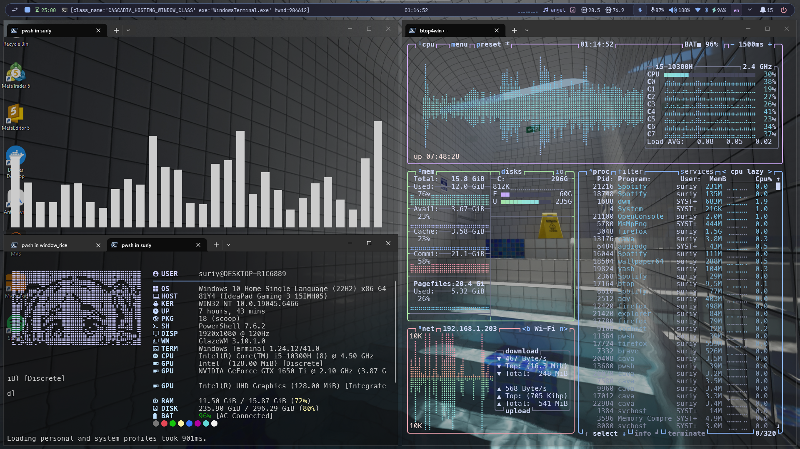
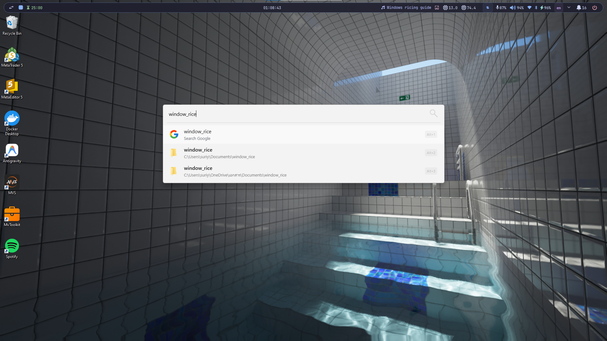
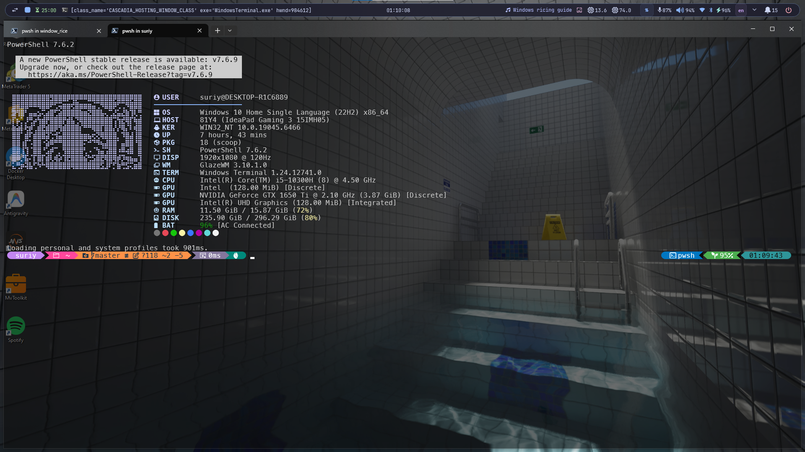

# 6e5tz Windows Dotfiles

[](https://github.com/suriyen-creator/6e5tz_window_rice)
[](LICENSE)

**English** | [ภาษาไทย](README.th.md)

A minimal, pastel-themed Windows desktop environment built around **GlazeWM**, **YASB**, **Flow Launcher**, and **Windows Terminal**, styled with the **Catppuccin Mocha** palette.



<p align="center">
  
  
</p>

---

## Highlights

- **Window Management:** GlazeWM tiling layout with 8px symmetrical gaps and focus-follows-cursor.
- **Top Bar:** Floating pill-shaped YASB bar with live traffic speeds, battery status, volume slider, media controls, and CAVA audio visualizer.
- **Wallpaper System:** Dual-mode architecture supporting both Steam Wallpaper Engine (CLI-driven playlist switching) and a native static image gallery with thumbnail preview.
- **Terminal Setup:** Windows Terminal with Acrylic transparency, PowerShell 7, Oh My Posh prompt, and Fastfetch with Frieren ASCII art.
- **Productivity:** Flow Launcher customized with Catppuccin theme for instant app search and calculator.
- **No Windows Key Hijacking:** All tiling hotkeys use `Alt` to keep native shortcuts intact (`Win + Space` for language switching and `Win` key for system controls).

---

## Quick Install

Run **PowerShell** as Administrator, paste the command below, and press Enter:

```powershell
irm https://raw.githubusercontent.com/suriyen-creator/6e5tz_window_rice/main/install.ps1 | iex
```

### What the installer does:
1. Clones dotfiles to `$HOME\.dotfiles\window_rice`.
2. Shows an interactive prompt:
   - `[1] Full Installation`: Installs packages via WinGet, downloads MesloLGL Nerd Font, and deploys all configs.
   - `[2] Deploy Configs Only`: Skips package downloads and only writes configuration files.
   - `[3] Install Font Only`: Installs MesloLGL Nerd Font.
3. Automatically backs up existing user configurations with a timestamped `.backup-<timestamp>` suffix.
4. Detects whether Wallpaper Engine is installed and configures YASB accordingly.
5. Starts GlazeWM and YASB.

---

## Manual Installation (Using install.ps1)

If you prefer cloning the repository manually:

```powershell
# Clone the repository
git clone https://github.com/suriyen-creator/6e5tz_window_rice.git
cd 6e5tz_window_rice

# Run the installer
.\install.ps1
```

### Useful Flags:
```powershell
# Deploy configs without downloading software
.\install.ps1 -ConfigOnly

# Unattended / non-interactive installation
.\install.ps1 -Full -NonInteractive

# Explicitly choose wallpaper mode
.\install.ps1 -WallpaperMode Static
.\install.ps1 -WallpaperMode WallpaperEngine
```

---

## Zero-Script DIY Setup (For Security-Conscious Users)

If you prefer not running external PowerShell scripts on your machine, you can set up everything by hand. All configuration files in this repository are plain text (YAML, JSON, CSS) and can be audited before copying.

### 1. Install packages via official sources

Run the following commands using Microsoft's official WinGet package manager:

```powershell
# Tiling window manager and launcher
winget install glzr-io.glazewm
winget install Flow-Launcher.Flow-Launcher

# Terminal and prompt
winget install Microsoft.WindowsTerminal
winget install Microsoft.PowerShell
winget install JanDeDobbeleer.OhMyPosh
winget install Fastfetch-cli.Fastfetch
```

- **YASB:** Download the official `.msi` or `.zip` from the [amnweb/yasb releases](https://github.com/amnweb/yasb/releases).
- **MesloLGL Nerd Font:** Download `Meslo.zip` from [Nerd Fonts releases](https://github.com/ryanoasis/nerd-fonts/releases), extract, and install the `.ttf` files for all users.
- **Optional CLI utilities (via Scoop):** `scoop install yazi eza bat lazygit zoxide btop pipes-rs`

### 2. Copy configuration files

Clone or download this repository as a `.zip`, then place the files into their respective directories:

| Component | Source in Repository | Destination on Windows |
| --- | --- | --- |
| **GlazeWM** | `configs/glazewm/config.yaml` | `%USERPROFILE%\.glzr\glazewm\config.yaml` |
| **YASB Bar** | `configs/yasb/styles.css`<br>`configs/yasb/scripts/*` | `%USERPROFILE%\.config\yasb\styles.css`<br>`%USERPROFILE%\.config\yasb\scripts\` |
| **Windows Terminal** | `configs/terminal/settings.json` | `%LOCALAPPDATA%\Packages\Microsoft.WindowsTerminal_8wekyb3d8bbwe\LocalState\settings.json` |
| **Flow Launcher** | `configs/flow-launcher/Settings.json`<br>`configs/flow-launcher/themes/*` | `%APPDATA%\FlowLauncher\Settings\Settings.json`<br>`%APPDATA%\FlowLauncher\Themes\` |
| **Fastfetch** | `configs/fastfetch/*` | `%USERPROFILE%\.config\fastfetch\` |
| **Oh My Posh** | `configs/oh-my-posh/jandedobbeleer.omp.json` | `%USERPROFILE%\.config\jandedobbeleer.omp.json` |
| **PowerShell Profile** | `configs/powershell/Microsoft.PowerShell_profile.ps1` | `%USERPROFILE%\Documents\PowerShell\Microsoft.PowerShell_profile.ps1` |
| **CAVA** | `configs/cava/config` | `%USERPROFILE%\.config\cava\config` |
| **ExplorerBlurMica** *(Optional)* | `configs/explorer-blur-mica/*` | `%USERPROFILE%\.config\ExplorerBlurMica\` |
| **Nilesoft Shell** *(Optional)* | `configs/nilesoft-shell/shell.nss` | `%USERPROFILE%\.config\nilesoft-shell\shell.nss` |

### 3. Choose your wallpaper configuration

Select one of the two configurations and copy it to `%USERPROFILE%\.config\yasb\config.yaml`:

- **For Wallpaper Engine users:**
  1. Copy `configs/yasb/config.wallpaper-engine.yaml` to `%USERPROFILE%\.config\yasb\config.yaml`.
  2. Open the file in a text editor, search for `__USERPROFILE__`, and replace it with your home path using forward slashes (e.g. `C:/Users/YourUsername`).
- **For Static Wallpaper users:**
  1. Copy `configs/yasb/config.static.yaml` to `%USERPROFILE%\.config\yasb\config.yaml`.
  2. Replace `__USERPROFILE__` with your home path using forward slashes.
  3. Copy the sample images from `wallpapers/` to `%USERPROFILE%\Pictures\Wallpapers\`.

### 4. Start services
Launch `glazewm.exe` and `yasb.exe` from the Start Menu. Press `Alt + Enter` to open Windows Terminal.

---

## Wallpaper System

The setup provides two dedicated wallpaper operating modes:

### 1. Wallpaper Engine Mode
Designed for machines with Wallpaper Engine installed via Steam. The bar communicates directly with `wallpaper64.exe` via CLI:
- **Left-Click on `󰸉`:** Advance to next wallpaper in playlist (`nextWallpaper`).
- **Right-Click on `󰸉`:** Toggle pause / resume to free GPU resources.
- **Middle-Click on `󰸉`:** Open Wallpaper Engine user interface.

### 2. Static Wallpaper Mode
Designed for standard Windows desktop wallpapers without running third-party engine processes:
- **Left-Click on `󰸉`:** Opens an interactive popup gallery displaying thumbnails with pagination. Click any image to apply it as your desktop wallpaper immediately.
- Loads images directly from `%USERPROFILE%\Pictures\Wallpapers\`.
- 10 sample high-resolution wallpapers are included in `wallpapers/`.

### Switching Modes:
```powershell
# Interactive selection menu
.\scripts\switch-wallpaper-mode.ps1

# Direct switch
.\scripts\switch-wallpaper-mode.ps1 -Mode Static
.\scripts\switch-wallpaper-mode.ps1 -Mode WallpaperEngine
```

---

## Keyboard Shortcuts

All window management shortcuts use `Alt` to prevent interference with Windows native combinations such as `Win + Space` (input language toggle) and `Win` (Start menu / Flow Launcher).

### Focus & Navigation
| Hotkey | Action |
| --- | --- |
| `Alt + H` / `Left` | Focus left window |
| `Alt + L` / `Right` | Focus right window |
| `Alt + K` / `Up` | Focus window above |
| `Alt + J` / `Down` | Focus window below |
| `Alt + Space` | Cycle focus (Tiling -> Floating -> Fullscreen) |
| `Alt + S` | Focus next active workspace |
| `Alt + A` | Focus previous active workspace |
| `Alt + D` | Switch to recent workspace |

### Window Placement
| Hotkey | Action |
| --- | --- |
| `Alt + Shift + H` / `Left` | Move window left |
| `Alt + Shift + L` / `Right` | Move window right |
| `Alt + Shift + K` / `Up` | Move window up |
| `Alt + Shift + J` / `Down` | Move window down |
| `Alt + Shift + Space` | Toggle floating (centered) |
| `Alt + T` | Return window to tiling |
| `Alt + F` | Toggle fullscreen |
| `Alt + M` | Minimize window |
| `Alt + Shift + Q` | Close focused window |
| `Alt + V` | Toggle split direction (Horizontal / Vertical) |

### Window Resizing
| Hotkey | Action |
| --- | --- |
| `Alt + U` / `Alt + P` | Decrease / Increase window width (-2% / +2%) |
| `Alt + I` / `Alt + O` | Decrease / Increase window height (-2% / +2%) |
| `Alt + R` | Enter Resize Mode (`H/J/K/L` or arrows to resize, `Enter` or `Esc` to exit) |

### Workspaces & Monitors
| Hotkey | Action |
| --- | --- |
| `Alt + 1` .. `Alt + 9` | Switch to Workspace 1 through 9 |
| `Alt + Shift + 1` .. `9` | Move window to Workspace and follow focus |
| `Alt + Shift + A` | Move workspace to left monitor |
| `Alt + Shift + F` | Move workspace to right monitor |
| `Alt + Shift + D` | Move workspace to upper monitor |
| `Alt + Shift + S` | Move workspace to lower monitor |

### System & Process Controls
| Hotkey | Action |
| --- | --- |
| `Alt + Enter` | Open Windows Terminal |
| `Alt + Shift + R` | Reload GlazeWM configuration |
| `Alt + Shift + W` | Redraw all windows |
| `Alt + Shift + P` | Pause window management |
| `Alt + Shift + E` | Exit GlazeWM process |

### Flow Launcher
| Hotkey | Action |
| --- | --- |
| `Ctrl + Space` | Toggle Flow Launcher search bar |
| `F1` | Quick preview file / item |
| `Ctrl + O` | Open context menu for selected item |
| `Ctrl + I` | Open Flow Launcher settings |
| `Ctrl + H` | View search history |
| `Tab` / `Ctrl + Tab` | Select next result / Auto-complete |

---

## Top Bar Interactions (YASB)

| Widget | Interaction |
| --- | --- |
| **Workspaces (1-9)** | Click to navigate directly to workspace |
| **Media Player** | Left-click: Play/Pause. Click track name to focus media application |
| **Clock / Date** | Left-click: Open calendar and time panel |
| **Wallpaper (󰸉)** | Wallpaper Engine mode: Left-click next, Right-click pause, Middle-click open UI.<br>Static mode: Left-click opens gallery popup |
| **Network / Wi-Fi** | Left-click: Open connection details and IP menu |
| **Bluetooth** | Left-click: Open Bluetooth devices menu |
| **Volume** | Scroll wheel: Adjust volume. Left-click: Toggle mute |
| **Battery** | Left-click: Toggle percentage / remaining time / power mode |
| **Traffic** | Left-click: Toggle between detailed rate (`↓`/`↑`) and compact indicator (`⇅`) |

---

## Included Components

| Component | Role | Config Location |
| --- | --- | --- |
| **GlazeWM** | Tiling window manager for Windows | `configs/glazewm/config.yaml` |
| **YASB** | Status bar styled as a floating pill capsule | `configs/yasb/` |
| **Flow Launcher** | Spotlight-like application and file launcher | `configs/flow-launcher/` |
| **Fastfetch** | System information fetch with Frieren ASCII | `configs/fastfetch/` |
| **Oh My Posh** | Shell prompt engine with Git integration | `configs/oh-my-posh/` |
| **CAVA** | Audio spectrum visualizer integrated into YASB | `configs/cava/` |
| **pipes-rs** | 60fps Rust terminal pipes screensaver (`pipes`) | Installed via Scoop |
| **yazi** | Terminal file manager with Vim keybindings (`y`) | Installed via Scoop |
| **eza** | Modern replacement for `ls` with Nerd Font icons (`ls`, `ll`) | Installed via Scoop |
| **bat** | Cat clone with syntax highlighting (`cat`) | Installed via Scoop |
| **lazygit** | Terminal UI for Git operations (`lg`) | Installed via Scoop |
| **zoxide** | Fast directory jumper (`z`) | Installed via Scoop |
| **Windows Terminal** | Translucent Acrylic themed terminal | `configs/terminal/settings.json` |
| **PowerShell 7** | Profile with aliases and integrations | `configs/powershell/` |
| **HideTaskbar** | Utility to hide native Windows taskbar | `configs/hidetaskbar/` |
| **Btop** | Hardware resource monitor (Catppuccin Mocha) | `configs/btop/` |
| **ExplorerBlurMica** | Acrylic blur and tint for File Explorer | `configs/explorer-blur-mica/` |
| **Nilesoft Shell** | Modern Acrylic right-click context menu | `configs/nilesoft-shell/shell.nss` |
| **Spicetify** | Spotify desktop mod with Marketplace and Adblock | `configs/spicetify/` |
| **ModernFlyouts** | Translucent media and volume OSD | Installed via WinGet |
| **Vencord** | Discord client mod with Catppuccin theme | `configs/vencord/` |

---

## Optional Modules Setup

1. **ExplorerBlurMica (Transparent File Explorer):**
   - Go to `~/.config/ExplorerBlurMica`.
   - Right-click `register.cmd` and select **Run as administrator**.
   - Press `Ctrl + F1` in File Explorer to collapse the ribbon and reveal edge-to-edge Acrylic blur.

2. **Nilesoft Shell (Catppuccin Context Menu):**
   - Install via Scoop: `scoop install extras/nilesoft-shell`.
   - Register the extension:
     ```powershell
     shell -register
     ```
   - Restart Explorer (`Stop-Process -Name explorer`). Open settings anytime with `Ctrl + Right-Click` on desktop.

3. **Spicetify (Marketplace & Adblock):**
   - Comes pre-configured with the extension store and adblock.
   - Run in PowerShell:
     ```powershell
     spicetify backup apply
     ```

4. **Vencord (Discord Catppuccin Theme):**
   - The installer places the theme at `%APPDATA%\Vencord\themes\catppuccin-mocha.theme.css`.
   - In Discord, enable it under `Settings > Vencord > Themes`.

---

## Backup Your Changes

To back up any changes made to your local configuration files back into this repository:

```powershell
.\backup.ps1
```

The script automatically strips sensitive tokens and converts absolute system paths to portable markers (`__USERPROFILE__`, `__APPDATA__`), making it safe to commit and push.

---

## Credits

- **Base Setup:** Based on [SleepyCatHey/Yasb-GlazeWM-Config](https://github.com/SleepyCatHey/Yasb-GlazeWM-Config) by [@SleepyCatHey](https://github.com/SleepyCatHey).
- **Color Palette:** [Catppuccin](https://github.com/catppuccin) for the pastel theme across Btop, Spicetify, Vencord, and ExplorerBlurMica.
- **Fastfetch Art:** Anime braille art community.
- **Projects:** [GlazeWM](https://github.com/glzr-io/glazewm), [YASB](https://github.com/amnweb/yasb), [Flow Launcher](https://github.com/Flow-Launcher/Flow.Launcher), [Oh My Posh](https://ohmyposh.dev/), [Fastfetch](https://github.com/fastfetch-cli/fastfetch), [CAVA](https://github.com/karlstav/cava), [btop4win](https://github.com/aristocratos/btop4win), [ExplorerBlurMica](https://github.com/Maplespe/ExplorerBlurMica), [Spicetify](https://github.com/spicetify/cli), [ModernFlyouts](https://github.com/ModernFlyouts-Community/ModernFlyouts), [Vencord](https://github.com/Vendicated/Vencord).
