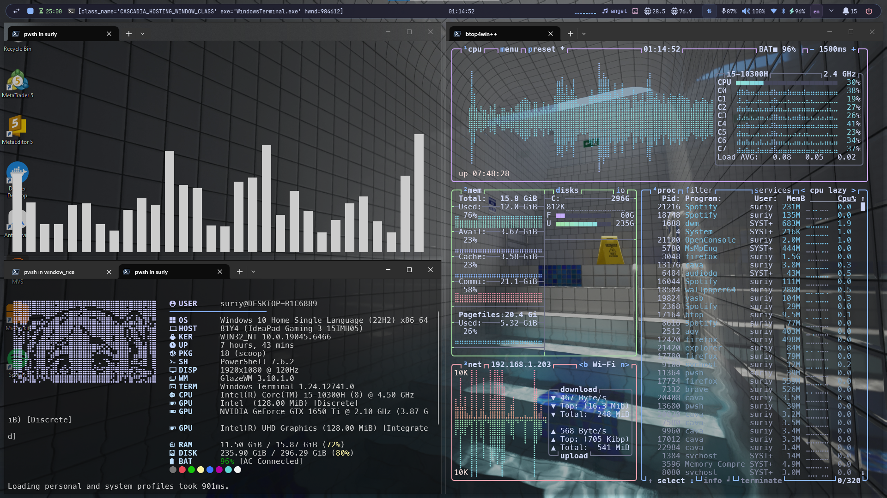
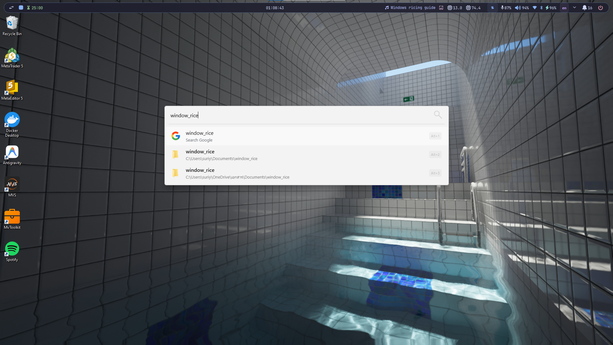
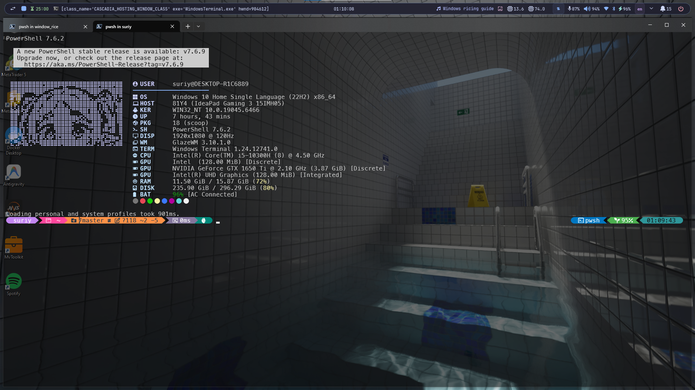

# 6e5tz Windows Dotfiles

[](https://github.com/suriyen-creator/6e5tz_window_rice)
[](LICENSE)

[English](README.md) | **ภาษาไทย**

ชุดปรับแต่ง Desktop สำหรับ Windows สไตล์ Tiling Window Manager ขับเคลื่อนด้วย **GlazeWM**, **YASB**, **Flow Launcher**, และ **Windows Terminal** ในธีมสีพาสเทล **Catppuccin Mocha**



<p align="center">
  
  
</p>

---

## จุดเด่น

- **ระบบจัดหน้าต่าง (Tiling):** GlazeWM เว้นระยะขอบสมมาตร 8px รอบด้าน พร้อมเปิดใช้งาน Focus-Follows-Cursor (เลื่อนเมาส์ไปหน้าต่างไหน โฟกัสตามทันที)
- **แถบสถานะด้านบน (Top Bar):** YASB ทรงแคปซูลลอย แสดงความเร็วเน็ตสด, เปอร์เซ็นต์แบตเตอรี่, แถบปรับเสียง, ควบคุมเพลง, และคลื่นเสียง CAVA Visualizer
- **ระบบ Wallpaper 2 โหมด:** รองรับทั้งคนที่ใช้ Wallpaper Engine (สั่ง Next/Pause ผ่าน CLI) และคนที่ใช้ภาพนิ่งปกติ (มี Popup Gallery เลือกรูปภาพขนาดย่อในตัว)
- **ปุ่มลัดสลับ Wallpaper สากล:** กด `Alt + W` เพื่อสลับไปภาพถัดไปได้ทันทีทั้งสองโหมด
- **เทอร์มินัลครบชุด:** Windows Terminal โปร่งแสง Acrylic + PowerShell 7 + Oh My Posh + Fastfetch ฟรีเรน พร้อมคำสั่งนาฬิกา `clock` และเอฟเฟกต์ฝนดิจิทัล `matrix`
- **เมนูค้นหาด่วน:** Flow Launcher ธีม Catppuccin ค้นหาแอป ไฟล์ และคิดเลขได้รวดเร็ว
- **ไม่ทับปุ่มลัดระบบ:** คีย์ลัดจัดการหน้าต่างทั้งหมดใช้ปุ่ม `Alt` เพื่อไม่ให้แย่งคีย์ลัดสำคัญของ Windows โดยเฉพาะ `Win + Space` สำหรับสลับภาษาไทย-อังกฤษที่ใช้งานได้ลื่นไหล 100%

---

## การติดตั้งด่วน (รองรับเครื่องใหม่แกะกล่อง)

สคริปต์ติดตั้งถูกออกแบบมาให้ทำงานได้ทันทีบน Windows เครื่องใหม่ที่เพิ่งลงวินโดวส์เสร็จและยังไม่เคยลงโปรแกรมสำหรับนักพัฒนาหรือ Package Manager ใดๆ มาก่อน

เปิด **PowerShell** (Run as Administrator) แล้ววางคำสั่งนี้แล้วกด Enter:

```powershell
Set-ExecutionPolicy RemoteSigned -Scope CurrentUser -Force; irm https://raw.githubusercontent.com/suriyen-creator/6e5tz_window_rice/main/install.ps1 | iex
```

### สิ่งที่ตัวติดตั้งจะจัดการให้อัตโนมัติ:
1. เปิดสิทธิ์การรันสคริปต์ PowerShell (`RemoteSigned` เฉพาะ CurrentUser)
2. โคลน dotfiles ไปไว้ที่ `$HOME\.dotfiles\window_rice`
3. ติดตั้งโปรแกรมหลักทั้งหมดผ่าน Microsoft WinGet
4. ตรวจสอบและติดตั้ง Scoop พร้อมเพิ่ม bucket `extras` อัตโนมัติหากยังไม่มีในเครื่อง
5. ติดตั้ง Python 3.12 และไลบรารี curses สำหรับรันสกรีนเซฟเวอร์เทอร์มินัล
6. ดาวน์โหลดและลงทะเบียนฟอนต์ MesloLGL Nerd Font ลงระบบ Windows Fonts
7. วางไฟล์คอนฟิก, สคริปต์เครื่องมือเสริม (`clock`, `unimatrix`) และชุดรูปภาพวอลเปเปอร์ตัวอย่าง
8. แบ็กอัปคอนฟิกเดิมของผู้ใช้เก็บไว้เป็น `.backup-<timestamp>` ป้องกันข้อมูลทับซ้อน
9. ตรวจจับอัตโนมัติว่าในเครื่องมี Wallpaper Engine หรือไม่ แล้วเลือกคอนฟิก YASB ที่เหมาะสมให้ทันที
10. เริ่มการทำงานของ GlazeWM และ YASB

---

## การติดตั้งแบบแมนนวล (ผ่าน install.ps1)

หากต้องการโคลน Repository มาตรวจสอบไฟล์ในเครื่องก่อนรัน:

```powershell
# โคลนโปรเจกต์
git clone https://github.com/suriyen-creator/6e5tz_window_rice.git
cd 6e5tz_window_rice

# รันตัวติดตั้ง
.\install.ps1
```

### พารามิเตอร์เพิ่มเติม:
```powershell
# วางเฉพาะไฟล์คอนฟิก (ไม่ดาวน์โหลดโปรแกรม)
.\install.ps1 -ConfigOnly

# ติดตั้งแบบ Non-interactive (ไม่ถามคำถาม)
.\install.ps1 -Full -NonInteractive

# เจาะจงโหมด Wallpaper ล่วงหน้า
.\install.ps1 -WallpaperMode Static
.\install.ps1 -WallpaperMode WallpaperEngine
```

---

## ติดตั้งเองทีละขั้นตอน (Zero-Script DIY Guide)

สำหรับผู้ที่กังวลเรื่องความปลอดภัยและไม่ต้องการรันสคริปต์อัตโนมัติจากอินเทอร์เน็ต สามารถติดตั้งโปรแกรมและคัดลอกไฟล์คอนฟิกได้ด้วยตนเอง 100% ไฟล์ทั้งหมดใน Repository นี้เป็น Plain Text (YAML, JSON, CSS) ตรวจสอบโค้ดทั้งหมดได้ก่อนนำไปใช้

### 1. ติดตั้งโปรแกรมผ่าน Official Source

ติดตั้งโปรแกรมหลักผ่าน WinGet ของ Microsoft:

```powershell
# Window Manager และ Launcher
winget install glzr-io.glazewm
winget install Flow-Launcher.Flow-Launcher

# Terminal, Shell, Prompt และ Python
winget install Microsoft.WindowsTerminal
winget install Microsoft.PowerShell
winget install JanDeDobbeleer.OhMyPosh
winget install Fastfetch-cli.Fastfetch
winget install Python.Python.3.12

# ไลบรารีสำหรับ Unimatrix
pip install windows-curses
```

- **YASB:** ดาวน์โหลดตัวติดตั้งทางการจาก [amnweb/yasb Releases](https://github.com/amnweb/yasb/releases)
- **MesloLGL Nerd Font:** ดาวน์โหลด `Meslo.zip` จาก [Nerd Fonts Releases](https://github.com/ryanoasis/nerd-fonts/releases) แตกไฟล์ `.ttf` แล้วคลิกขวาเลือก **Install for all users**
- **เครื่องมือเสริมบน Terminal (ผ่าน Scoop):** `scoop install yazi eza bat lazygit zoxide btop pipes-rs`

### 2. คัดลอกไฟล์คอนฟิกไปยังโฟลเดอร์ของระบบ

ดาวน์โหลด Repository นี้มา แล้วคัดลอกไฟล์ไปยังโฟลเดอร์ปลายทางตามตารางนี้:

| โปรแกรม | ไฟล์ต้นฉบับใน Repo | โฟลเดอร์ปลายทางบน Windows |
| --- | --- | --- |
| **GlazeWM** | `configs/glazewm/config.yaml` | `%USERPROFILE%\.glzr\glazewm\config.yaml` |
| **YASB Bar** | `configs/yasb/styles.css`<br>`configs/yasb/scripts/*` | `%USERPROFILE%\.config\yasb\styles.css`<br>`%USERPROFILE%\.config\yasb\scripts\` |
| **Terminal Tools** | `configs/tools/*` | `%USERPROFILE%\.config\tools\` |
| **Windows Terminal** | `configs/terminal/settings.json` | `%LOCALAPPDATA%\Packages\Microsoft.WindowsTerminal_8wekyb3d8bbwe\LocalState\settings.json` |
| **Flow Launcher** | `configs/flow-launcher/Settings.json`<br>`configs/flow-launcher/themes/*` | `%APPDATA%\FlowLauncher\Settings\Settings.json`<br>`%APPDATA%\FlowLauncher\Themes\` |
| **Fastfetch** | `configs/fastfetch/*` | `%USERPROFILE%\.config\fastfetch\` |
| **Oh My Posh** | `configs/oh-my-posh/jandedobbeleer.omp.json` | `%USERPROFILE%\.config\jandedobbeleer.omp.json` |
| **PowerShell Profile** | `configs/powershell/Microsoft.PowerShell_profile.ps1` | `%USERPROFILE%\Documents\PowerShell\Microsoft.PowerShell_profile.ps1` |
| **CAVA** | `configs/cava/config` | `%USERPROFILE%\.config\cava\config` |
| **ExplorerBlurMica** *(ไม่บังคับ)* | `configs/explorer-blur-mica/*` | `%USERPROFILE%\.config\ExplorerBlurMica\` |
| **Nilesoft Shell** *(ไม่บังคับ)* | `configs/nilesoft-shell/shell.nss` | `%USERPROFILE%\.config\nilesoft-shell\shell.nss` |

### 3. เลือกโหมด Wallpaper

เลือกไฟล์คอนฟิก 1 ใน 2 แบบแล้วคัดลอกไปเป็น `%USERPROFILE%\.config\yasb\config.yaml`:

- **กรณีใช้ Wallpaper Engine:**
  1. ก๊อปปี้ `configs/yasb/config.wallpaper-engine.yaml` ไปเป็น `%USERPROFILE%\.config\yasb\config.yaml`
  2. เปิดไฟล์ด้วย Text Editor ค้นหาคำว่า `__USERPROFILE__` แล้วแทนที่ด้วยที่อยู่โฟลเดอร์ผู้ใช้ของคุณโดยใช้ Forward Slashes (เช่น `C:/Users/YourUsername`)
- **กรณีใช้ภาพนิ่ง (Static Wallpapers):**
  1. ก๊อปปี้ `configs/yasb/config.static.yaml` ไปเป็น `%USERPROFILE%\.config\yasb\config.yaml`
  2. แทนที่ `__USERPROFILE__` ด้วยที่อยู่โฟลเดอร์ผู้ใช้ของคุณเช่นกัน
  3. คัดลอกภาพตัวอย่างจากโฟลเดอร์ `wallpapers/` ไปไว้ที่ `%USERPROFILE%\Pictures\Wallpapers\`

### 4. เปิดใช้งาน
เปิดโปรแกรม `glazewm.exe` และ `yasb.exe` จาก Start Menu จากนั้นกด `Alt + Enter` เพื่อเปิด Windows Terminal

---

## ระบบจัดการ Wallpaper (2 โหมด)

### 1. โหมด Wallpaper Engine
เหมาะสำหรับเครื่องที่มี Wallpaper Engine บน Steam ตัววิดเจ็ตสื่อสารกับโปรเซสผ่าน CLI โดยตรง:
- **คลิกซ้ายที่ `󰸉`:** สลับไปวอลเปเปอร์ถัดไปในเพลย์ลิสต์ (`nextWallpaper`)
- **คลิกขวาที่ `󰸉`:** หยุดชั่วคราว / เล่นต่อ เพื่อประหยัดทรัพยากรการ์ดจอ
- **คลิกกลางที่ `󰸉`:** เปิดหน้าต่างหลัก Wallpaper Engine

### 2. โหมด Static Wallpaper
เหมาะสำหรับคนที่ใช้ภาพพื้นหลังปกติของ Windows โดยไม่ต้องรันโปรแกรมเสริม:
- **คลิกซ้ายที่ `󰸉`:** เปิด Popup Gallery สวยงาม แสดงรูปตัวอย่างขนาดย่อ สามารถคลิกเลือกภาพเพื่อเปลี่ยนพื้นหลังหน้าจอได้ทันที
- ดึงรูปภาพจากโฟลเดอร์ `%USERPROFILE%\Pictures\Wallpapers\`
- มีภาพ Wallpaper ความละเอียดสูงแถมมาให้ 10 รูปในโฟลเดอร์ `wallpapers/`

### ปุ่มลัดสลับ Wallpaper สากล:
- กด **`Alt + W`** ได้จากทุกหน้าจอเพื่อเปลี่ยนไปภาพถัดไปทันที ระบบจะตรวจจับโหมดอัตโนมัติ (หากเปิด Wallpaper Engine จะสั่งข้ามเพลง/ภาพในเพลย์ลิสต์ หากเป็น Static จะสลับรูปในโฟลเดอร์ให้ทันที)

### คำสั่งสลับโหมดได้ทุกเมื่อ:
```powershell
# เปิดเมนู Interactive ให้เลือกโหมด
.\scripts\switch-wallpaper-mode.ps1

# หรือสั่งสลับตรงๆ
.\scripts\switch-wallpaper-mode.ps1 -Mode Static
.\scripts\switch-wallpaper-mode.ps1 -Mode WallpaperEngine
```

---

## คลังคำสั่ง Terminal (Terminal Arsenal)

คำสั่งพร้อมใช้งานทันทีภายใน Windows Terminal (PowerShell 7):

| คำสั่ง | รายละเอียดการทำงาน |
| --- | --- |
| `clock` | นาฬิกา ASCII / TUI สไตล์มินิมอล พร้อมฟังก์ชันจับเวลาและ Pomodoro (`sigye` พร้อมระบบ Fallback เป็นนาฬิกา Pure PowerShell) |
| `matrix` / `unimatrix` | สกรีนเซฟเวอร์ฝนดิจิทัล The Matrix บน Terminal (Python + curses) |
| `pipes` | สกรีนเซฟเวอร์ท่อเลี้ยวสามมิติ 60fps เขียนด้วย Rust (`pipes-rs`) |
| `ff` | Fastfetch แสดงสเปกเครื่องพร้อม ASCII Art น้องฟรีเรน |
| `btop` | หน้าจอมอนิเตอร์ซีพียู แรม การ์ดจอ เน็ต และโปรเซส ธีม Catppuccin Mocha |
| `y` | ตัวจัดการไฟล์บน Terminal พร้อมคีย์ลัดสไตล์ Vim (`yazi`) |
| `lg` | จัดการ Git แบบกราฟิกบน Terminal (`lazygit`) |
| `ls` / `ll` | ดูรายการไฟล์พร้อมไอคอน Nerd Font และสถานะ Git (`eza`) |
| `cat` | อ่านเนื้อหาไฟล์พร้อมไฮไลต์สีโค้ดและเลขบรรทัด (`bat`) |
| `z <ชื่อโฟลเดอร์>` | กระโดดข้ามไดเรกทอรีด่วนอัจฉริยะ (`zoxide`) |

---

## สารบัญคีย์ลัด (Keyboard Shortcuts)

คีย์ลัดจัดการหน้าต่างทั้งหมดใช้ปุ่ม `Alt` เพื่อไม่ให้แย่งคีย์ลัดสำคัญของ Windows เช่น `Win + Space` (สลับภาษาไทย-อังกฤษ) และปุ่ม `Win` ของ Flow Launcher

### โฟกัสและการเลื่อนตำแหน่งหน้าต่าง
| คีย์ลัด | คำสั่ง / การทำงาน |
| --- | --- |
| `Alt + H` / `Left` | เลื่อนโฟกัสไปหน้าต่างซ้าย |
| `Alt + L` / `Right` | เลื่อนโฟกัสไปหน้าต่างขวา |
| `Alt + K` / `Up` | เลื่อนโฟกัสไปหน้าต่างบน |
| `Alt + J` / `Down` | เลื่อนโฟกัสไปหน้าต่างล่าง |
| `Alt + Space` | สลับโฟกัสวนข้ามสถานะ (Tiling -> Floating -> Fullscreen) |
| `Alt + S` | โฟกัสไปยัง Workspace ถัดไปที่มีหน้าต่างเปิดอยู่ |
| `Alt + A` | โฟกัสไปยัง Workspace ก่อนหน้าที่มีหน้าต่างเปิดอยู่ |
| `Alt + D` | สลับกลับไปยัง Workspace ล่าสุดที่เพิ่งใช้งาน |

### การจัดตำแหน่งและเลย์เอาต์หน้าต่าง
| คีย์ลัด | คำสั่ง / การทำงาน |
| --- | --- |
| `Alt + Shift + H` / `Left` | ย้ายหน้าต่างไปทางซ้าย |
| `Alt + Shift + L` / `Right` | ย้ายหน้าต่างไปทางขวา |
| `Alt + Shift + K` / `Up` | ย้ายหน้าต่างขึ้นบน |
| `Alt + Shift + J` / `Down` | ย้ายหน้าต่างลงล่าง |
| `Alt + Shift + Space` | ปลดหน้าต่างเป็นโหมดลอยอิสระ (Floating) |
| `Alt + T` | เปลี่ยนหน้าต่างกลับเป็นโหมดเรียงชิด (Tiling) |
| `Alt + F` | เปิด / ปิดโหมดขยายเต็มหน้าจอ (Fullscreen) |
| `Alt + M` | ย่อหน้าต่างลง Taskbar |
| `Alt + Shift + Q` | ปิดหน้าต่างที่กำลังโฟกัส |
| `Alt + V` | สลับทิศทางการแยกหน้าต่าง (แนวนอน / แนวตั้ง) |

### การปรับขนาดหน้าต่าง
| คีย์ลัด | คำสั่ง / การทำงาน |
| --- | --- |
| `Alt + U` / `Alt + P` | ลด / เพิ่มความกว้างหน้าต่าง (-2% / +2%) |
| `Alt + I` / `Alt + O` | ลด / เพิ่มความสูงหน้าต่าง (-2% / +2%) |
| `Alt + R` | เข้าสู่โหมดปรับขนาดอิสระ (ใช้ปุ่ม `H/J/K/L` หรือลูกศรยืดหด, กด `Enter` หรือ `Esc` เพื่อออก) |

### พื้นที่ทำงานและหน้าจอ (Workspaces & Monitors)
| คีย์ลัด | คำสั่ง / การทำงาน |
| --- | --- |
| `Alt + 1` .. `Alt + 9` | สลับไปยัง Workspace หมายเลข 1 ถึง 9 |
| `Alt + Shift + 1` .. `9` | ย้ายหน้าต่างไปยัง Workspace นั้นๆ พร้อมตามไปทันที |
| `Alt + Shift + A` | ย้าย Workspace ปัจจุบันไปยังจอด้านซ้าย |
| `Alt + Shift + F` | ย้าย Workspace ปัจจุบันไปยังจอด้านขวา |
| `Alt + Shift + D` | ย้าย Workspace ปัจจุบันไปยังจอด้านบน |
| `Alt + Shift + S` | ย้าย Workspace ปัจจุบันไปยังจอด้านล่าง |

### ปุ่มลัดด่วนและควบคุมระบบ
| คีย์ลัด | คำสั่ง / การทำงาน |
| --- | --- |
| `Alt + Enter` | **เปิด Windows Terminal ทันที** |
| `Alt + W` | **สลับ Wallpaper ถัดไป** (ทั้ง Wallpaper Engine และ Static Gallery) |
| `Win + Space` | **สลับภาษาไทย-อังกฤษของ Windows** (ไม่มีโปรแกรมใดดักจับ ใช้งานได้ 100%) |
| `Alt + Shift + R` | รีโหลดคอนฟิก GlazeWM โดยไม่ต้องรีสตาร์ต |
| `Alt + Shift + W` | วาดหน้าต่างใหม่ทั้งหมด แก้บั๊กจอกระพริบหรือภาพค้าง |
| `Alt + Shift + P` | หยุด/คืนค่าระบบจัดเรียงหน้าต่างชั่วคราว |
| `Alt + Shift + E` | ออกจาก GlazeWM อย่างปลอดภัย |

### Flow Launcher
| คีย์ลัด | คำสั่ง / การทำงาน |
| --- | --- |
| `Ctrl + Space` | เปิด/ปิดแถบค้นหา Flow Launcher |
| `F1` | ดูตัวอย่างไฟล์ (Quick Preview) |
| `Ctrl + O` | เปิด Context Menu ของผลลัพธ์ที่เลือก |
| `Ctrl + I` | เปิดหน้าต่าง Settings ของ Flow Launcher |
| `Ctrl + H` | ดูประวัติการค้นหาย้อนหลัง |
| `Tab` / `Ctrl + Tab` | เลือกผลลัพธ์ถัดไป / เติมคำอัตโนมัติ |

---

## การคลิกบนแถบ YASB

| วิดเจ็ต | การทำงาน |
| --- | --- |
| **Workspaces (1-9)** | คลิกเพื่อสลับหน้าต่างไปยัง Workspace นั้น |
| **Media Player** | คลิกซ้าย: เล่น/หยุดเพลง. คลิกที่ชื่อเพลงเพื่อเปิดโปรแกรมเล่นเพลง |
| **นาฬิกา / วันที่** | คลิกซ้าย: เปิดแผงปฏิทินและเวลา |
| **Wallpaper (`󰸉`)** | โหมด Wallpaper Engine: คลิกซ้ายเปลี่ยนภาพ, คลิกขวาหยุด/เล่นต่อ, คลิกกลางเปิด UI<br>โหมด Static: คลิกซ้ายเปิด Gallery Popup |
| **Network / Wi-Fi** | คลิกซ้าย: เปิดเมนูดูรายละเอียดการเชื่อมต่อและ IP |
| **Bluetooth** | คลิกซ้าย: เปิดเมนูจัดการอุปกรณ์ Bluetooth |
| **ระดับเสียง** | เลื่อนลูกกลิ้งเมาส์เพื่อปรับเสียง, คลิกซ้ายเพื่อ Mute (ทำงานแทน ModernFlyouts โดยไม่แย่งคีย์ลัด) |
| **แบตเตอรี่** | คลิกซ้ายเพื่อสลับดูเปอร์เซ็นต์ / เวลาที่เหลือ / โหมดพลังงาน |
| **Traffic (อินเทอร์เน็ต)** | คลิกซ้ายเพื่อสลับดูความเร็วแบบละเอียด (`↓`/`↑`) หรือแบบย่อ (`⇅`) |

> **หมายเหตุเรื่อง ModernFlyouts:** โปรเจกต์นี้ไม่รวม ModernFlyouts เนื่องจากโปรแกรมมีบั๊ก Low-level Keyboard Hook (Issue #584) ซึ่งส่งผลให้ปุ่ม `Win + Space` สำหรับเปลี่ยนภาษาไทย-อังกฤษไม่ทำงาน การควบคุมเสียงและเพลงทั้งหมดถูกรวมไว้บน YASB เรียบร้อยแล้วโดยไม่มีการดักปุ่มลัดระบบใดๆ

---

## ส่วนประกอบทั้งหมดที่ติดตั้ง

| โปรแกรม | หน้าที่ | ตำแหน่งคอนฟิก |
| --- | --- | --- |
| **GlazeWM** | ระบบจัดการหน้าต่างแบบเรียงชิด (Tiling) บน Windows | `configs/glazewm/config.yaml` |
| **YASB** | แถบสถานะทรงแคปซูลลอยด้านบนจอ | `configs/yasb/` |
| **Flow Launcher** | ตัวค้นหาโปรแกรม ไฟล์ และเครื่องคิดเลขด่วน | `configs/flow-launcher/` |
| **Fastfetch** | แสดงสเปกเครื่องพร้อม ASCII Art น้องฟรีเรน | `configs/fastfetch/` |
| **Oh My Posh** | ตกแต่งแถบ Shell Prompt พร้อมสถานะ Git | `configs/oh-my-posh/` |
| **CAVA** | คลื่นเสียงดนตรีสดที่ฝังอยู่บน YASB | `configs/cava/` |
| **sigye** | นาฬิกา TUI/ASCII และตัวจับเวลา Pomodoro (`clock`) | `configs/tools/sigye.exe` |
| **unimatrix** | สกรีนเซฟเวอร์ฝนดิจิทัล The Matrix บน Terminal (`matrix`) | `configs/tools/unimatrix.py` |
| **pipes-rs** | สกรีนเซฟเวอร์ท่อเลี้ยว 60fps (`pipes`) | ติดตั้งผ่าน Scoop |
| **yazi** | ตัวจัดการไฟล์ใน Terminal คีย์ลัด Vim (`y`) | ติดตั้งผ่าน Scoop |
| **eza** | แสดงรายการไฟล์พร้อมไอคอน (`ls`, `ll`) | ติดตั้งผ่าน Scoop |
| **bat** | ตัวอ่านไฟล์พร้อมไฮไลต์โค้ด (`cat`) | ติดตั้งผ่าน Scoop |
| **lazygit** | จัดการ Git บน Terminal (`lg`) | ติดตั้งผ่าน Scoop |
| **zoxide** | กระโดดโฟลเดอร์อัจฉริยะ (`z`) | ติดตั้งผ่าน Scoop |
| **Windows Terminal** | เทอร์มินัลโปร่งแสง Acrylic | `configs/terminal/settings.json` |
| **PowerShell 7** | สคริปต์ Profile พร้อม Alias และคำสั่งลัด | `configs/powershell/` |
| **HideTaskbar** | ยูทิลิตีซ่อน Windows Taskbar เดิม | `configs/hidetaskbar/` |
| **Btop** | มอนิเตอร์ทรัพยากรระบบ ธีม Catppuccin Mocha | `configs/btop/` |
| **ExplorerBlurMica** | ปรับแต่ง File Explorer ให้โปร่งแสง Acrylic | `configs/explorer-blur-mica/` |
| **Nilesoft Shell** | เมนูคลิกขวาสไตล์โมเดิร์น Acrylic | `configs/nilesoft-shell/shell.nss` |
| **Spicetify** | ปรับแต่ง Spotify พร้อมหน้าร้าน Extension และบล็อกโฆษณา | `configs/spicetify/` |
| **Vencord** | Discord Client Mod พร้อมธีม Catppuccin | `configs/vencord/` |

---

## ส่วนเสริมพิเศษ (Optional Modules)

1. **ExplorerBlurMica (ทำให้ File Explorer โปร่งแสง):**
   - ไปที่ `~/.config/ExplorerBlurMica`
   - คลิกขวาที่ `register.cmd` เลือก **Run as administrator**
   - กด `Ctrl + F1` ใน File Explorer เพื่อย่อแถบ Ribbon ด้านบน ให้กระจก Acrylic Blur แสดงผลเต็มบาน

2. **Nilesoft Shell (เมนูคลิกขวา Catppuccin):**
   - ติดตั้งผ่าน Scoop: `scoop install extras/nilesoft-shell`
   - ลงทะเบียนส่วนขยาย:
     ```powershell
     shell -register
     ```
   - รีสตาร์ต Explorer (`Stop-Process -Name explorer`). สามารถกด `Ctrl + คลิกขวา` บน Desktop เพื่อเข้าเมนูตั้งค่าได้ตลอดเวลา

3. **Spicetify (Marketplace & Adblock สำหรับ Spotify):**
   - มีหน้าร้านดาวน์โหลดส่วนเสริมและตัวบล็อกโฆษณาติดตั้งมาให้พร้อม
   - รันใน PowerShell:
     ```powershell
     spicetify backup apply
     ```

4. **Vencord (ธีม Catppuccin สำหรับ Discord):**
   - ไฟล์ธีมถูกวางไว้ที่ `%APPDATA%\Vencord\themes\catppuccin-mocha.theme.css`
   - เปิด Discord แล้วเข้าไปเปิดใช้งานธีมที่ `Settings > Vencord > Themes`

---

## สำรองข้อมูลกลับเข้า Repo (Backup)

หากคุณปรับแต่งตำแหน่งหรือสีเพิ่มเติม และต้องการเซฟการเปลี่ยนแปลงกลับเข้ามาที่ Repository:

```powershell
.\backup.ps1
```

สคริปต์จะแปลงพาธเครื่องผู้ใช้เป็นตัวแปรพกพา (`__USERPROFILE__`, `__APPDATA__`) และตัดข้อมูลส่วนตัวออกให้อัตโนมัติ ปลอดภัยต่อการพุชขึ้น GitHub

---

## เครดิต (Credits)

- **โครงคอนฟิกตั้งต้น:** ดัดแปลงมาจาก [SleepyCatHey/Yasb-GlazeWM-Config](https://github.com/SleepyCatHey/Yasb-GlazeWM-Config) โดย [@SleepyCatHey](https://github.com/SleepyCatHey)
- **ชุดสี:** [Catppuccin](https://github.com/catppuccin) Mocha สำหรับโทนสีพาสเทลบน Btop, Spicetify, Vencord และ ExplorerBlurMica
- **ASCII Art ฟรีเรน:** ชุมชน Anime braille art
- **เครื่องมือโอเพนซอร์ส:** [GlazeWM](https://github.com/glzr-io/glazewm), [YASB](https://github.com/amnweb/yasb), [Flow Launcher](https://github.com/Flow-Launcher/Flow.Launcher), [Oh My Posh](https://ohmyposh.dev/), [Fastfetch](https://github.com/fastfetch-cli/fastfetch), [CAVA](https://github.com/karlstav/cava), [btop4win](https://github.com/aristocratos/btop4win), [ExplorerBlurMica](https://github.com/Maplespe/ExplorerBlurMica), [Spicetify](https://github.com/spicetify/cli), [Vencord](https://github.com/Vendicated/Vencord), [sigye](https://github.com/koonwen/sigye), [unimatrix](https://github.com/will8211/unimatrix)
